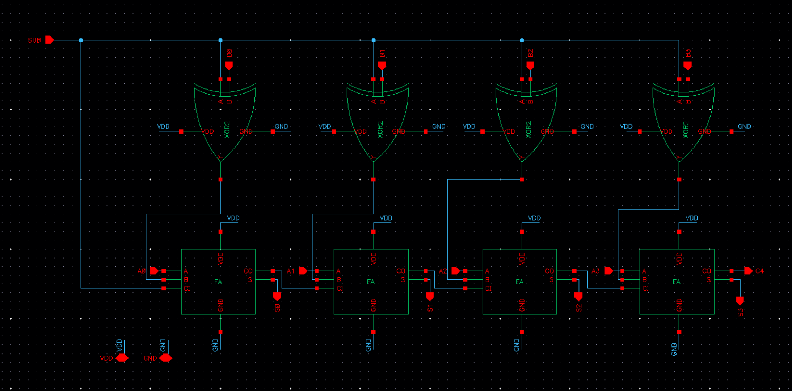
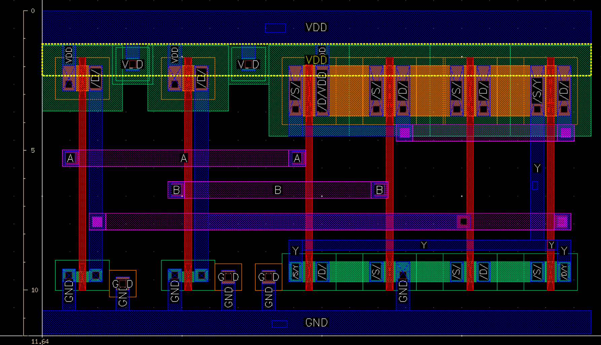
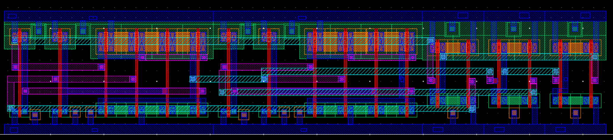
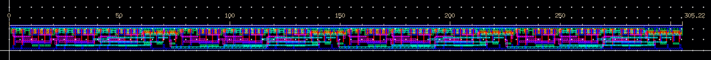
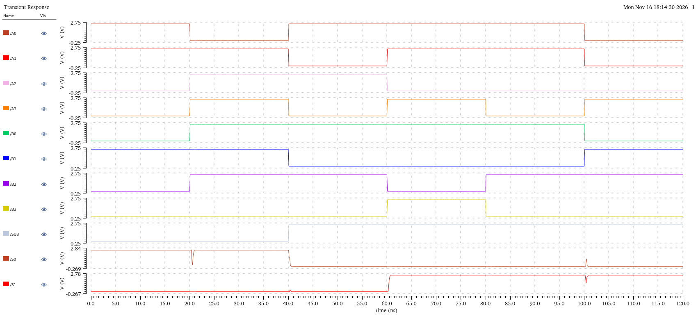
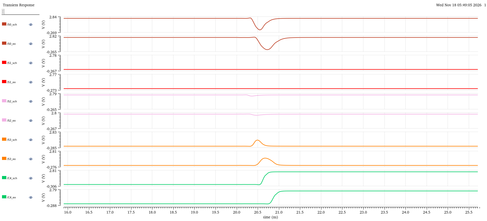

# 4-bit CMOS Adder/Subtractor

**EECS 119 · Digital Integrated Circuits · UC Irvine · Fall 2026**

A transistor-level **4-bit ripple-carry adder/subtractor** designed from custom static CMOS standard cells in Cadence Virtuoso. The project covers gate design and transistor sizing, hierarchical schematic construction, physical layout, DRC/LVS verification, and post-layout timing analysis.



## Overview

A single control signal selects the arithmetic operation:

| `SUB` | Operation | Implementation |
|:---:|---|---|
| `0` | `A + B` | Pass the B bits unchanged; initial carry = 0 |
| `1` | `A - B` | Invert every B bit and add 1 (two's complement) |

For each bit, `Bᵢ' = Bᵢ XOR SUB`, with `C₀ = SUB`, giving:

```text
S[3:0] = (A[3:0] + (B[3:0] XOR {4{SUB}}) + SUB) mod 16
```

Four full adders form a ripple-carry chain. The final carry-out, `C4`, serves as the fifth bit for unsigned addition and as a **no-borrow indicator** for subtraction (`C4 = 1` means no borrow).

## Design

| Building block | CMOS implementation | Transistors per block | Used in top level |
|---|---|---:|---:|
| `nand2` | 2 PMOS + 2 NMOS | 4 | 12 (inside the four full adders) |
| `xor2` | Two input inverters + AOI22 core | 12 | 12 (8 inside full adders, 4 on B inputs) |
| `fa` | 2 XOR2 + 3 NAND2 | 36 | 4 |
| **`addsub4`** | **4 XOR2 + 4 FA** | — | **192 MOSFETs total** |

The XOR2 uses a 12-transistor AOI22-based implementation. Transistor widths were sized relative to a Project 1 inverter ratio of `Wp/Wn = 2.417`, with a common `L = 0.24 µm` and `VDD = 2.5 V`.

| Device group | Width |
|---|---:|
| Reference inverter NMOS / PMOS | 0.36 / 0.90 µm |
| NAND2 NMOS / PMOS | 0.72 / 0.90 µm |
| XOR2 AOI22 NMOS / PMOS | 0.72 / 1.80 µm |

## Physical layout

The NAND2 and XOR2 cells use a common **11.64 µm standard-cell height**, aligned Metal1 power rails, and compatible n-well boundaries. Higher-level cells reuse these layouts hierarchically, with signal routing across Metal2 and Metal3.

**XOR2 standard cell**



**Hierarchical full-adder layout**



**Complete 4-bit adder/subtractor layout**



| Layout metric | Measured value |
|---|---:|
| Width | 305.22 µm |
| Height | 11.64 µm |
| Bounding-box area | **3,552.76 µm²** |

## Functional verification

The full adder was checked against all **8 input combinations**. The four-bit circuit was then evaluated against six addition/subtraction cases using a Spectre transient simulation with fan-out-of-one inverter loads on `S0–S3` and `C4`.

| `SUB` | `A` (decimal) | `B` (decimal) | Result | `C4 S3S2S1S0` |
|:---:|---:|---:|---:|:---:|
| 0 | 3 | 2 | 5 | `0 0101` |
| 0 | 14 | 7 | 21 | `1 0101` |
| 1 | 5 | 5 | 0 | `1 0000` |
| 1 | 11 | 9 | 2 | `1 0010` |
| 1 | 3 | 5 | −2 | `0 1110` |
| 1 | 8 | 6 | 2 | `1 0010` |

All six test cases matched the expected settled logic values, both before and after layout extraction. A low output was required to be at most **0.25 V**, and a high output at least **2.25 V**.



## DRC, LVS & post-layout timing

- **DRC:** Clean, with zero reported violations for the completed layouts.
- **LVS:** Schematic and extracted netlists matched for the standard cells and assembled design.
- **Parasitic extraction:** `extracted_c` view used for the post-layout Spectre comparison.
- **Functionality:** The extracted circuit reproduced all six expected arithmetic results.

The second rising-edge carry propagation was measured from `SUB` to `C4` at the **1.25 V crossing**, with `A = B = 0000`:

| Carry-chain delay | Value |
|---|---:|
| Schematic | 1.184 ns |
| Post-layout extracted | 1.716 ns |
| Increase | **0.532 ns (+44.9%)** |

The increased delay is consistent with the effect of additional interconnect and device parasitic capacitances. The transient comparison also shows changes in output-edge timing and glitch widths, while the final logic values remain correct.



## Tools

- **Cadence Virtuoso** — transistor schematics, cell symbols, standard-cell layout
- **Spectre** — transient and post-layout circuit simulation
- **Diva** — DRC, extraction, and LVS
- **NCSU / course-provided CMOS technology environment** — device and layout rules

## Repository notes

This README includes figures exported from the project report. For a more complete repository, add a `docs/` directory containing the report PDF and, **if redistribution is permitted**, your original Virtuoso design-library files. Recreating the simulations requires access to a compatible technology/PDK and models; do not upload licensed foundry or course-provided PDK files without permission.

**Project team:** Bao Nguyen and Ronnie Roi Gonzaga.
